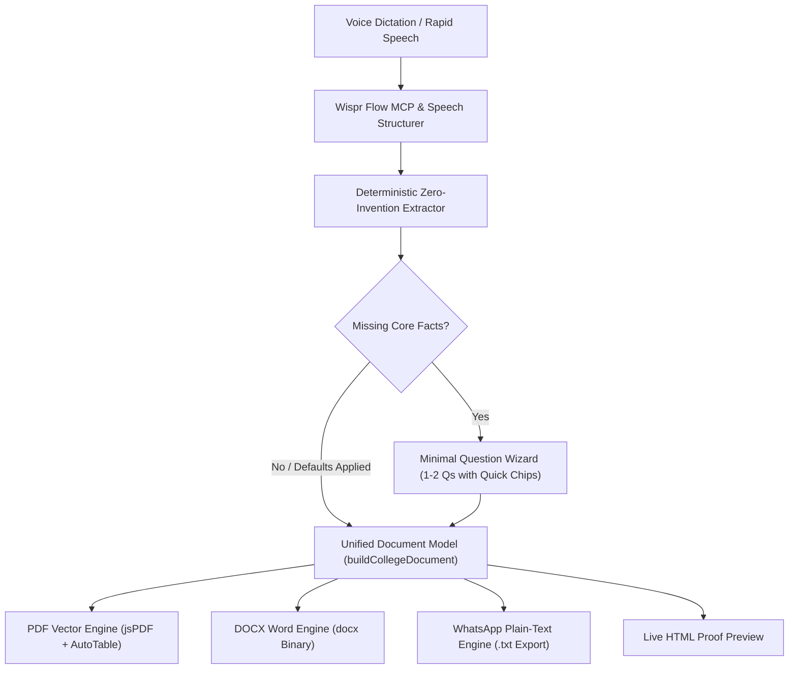

# WisprScribe

> **Speak what happened at your college event. Get verified, real-world collegiate paperwork in seconds without typing it all out.**

[](https://nextjs.org/)
[](https://www.typescriptlang.org/)
[](https://tailwindcss.com/)
[](https://gsap.com/)
[](https://wisprflow.ai/)

---

## 1. Problem & Motivation

Student coordinators, club leads, and faculty organize workshops, technical meetups, hackathons, and departmental seminars. After every event, they repeatedly re-type the exact same information across multiple separate formal formats:

1. **Permission Letters** (administrative requests for approval and hall reservation)
2. **Post-Event Summary Reports** (accreditation and departmental audit records)
3. **Sanction & Budget Clearances** (financial reimbursements and formal archival)
4. **WhatsApp Community Announcements** (instant student broadcasts)

### The Dilemma
- **Manual Overhead**: Coordinators spend **30+ minutes** formatting documents in Microsoft Word, aligning letterheads, adjusting tables, and retyping speaker bios.
- **Fast-Speech Pitfalls**: When dictating event recaps via microphone, fast speech causes run-on sentences, verbal false-starts, and speech-to-text phonetic mishearings (e.g., *"metre to"* for *"Meetup"*, *"CMI Technical Campus"* for *"CMR Technical Campus"*, *"cseml"* for *"CSE AI&ML"*, *"senior Software Engineering"* for *"Senior Software Engineer"*).
- **The Hallucination Problem**: Traditional generative AI fabricates unmentioned details—inventing biometric headcounts, geotagged timestamps, PO/PSO mappings, or fake faculty names.

---

## 2. The WisprScribe Solution

**WisprScribe** bridges voice dictation and formal academic bureaucracy through a zero-invention, high-speed pipeline:

$$\text{Speak Rapidly Once} \longrightarrow \text{Wispr MCP Fast Structuring} \longrightarrow \text{Low-Friction 1-Click Review} \longrightarrow \text{Real PDF \& DOCX Generation}$$

### Core Tenets
1. **The Zero-Invention Rule**: *"If you did not say it, WisprScribe never invents it."* Unstated fields remain strictly unconfirmed and are visibly highlighted with amber `[To be confirmed: <field>]` tags.
2. **Wispr Flow MCP Backend Integration**: Connects to the remote Wispr Flow MCP server (`https://api.wisprflow.ai/connect/mcp`) via JSON-RPC 2.0 with a local phonetic speech normalization fallback engine.
3. **The ONE Unified College Document Format**: All document types share the exact same institutional letterhead, rule, Ref/Date row, recipient block, hanging-indent `Sub:` line, details table, and 4-column signature row. Only the body sequence adapts to the document's purpose.
4. **Real Binary Exports**: Authentic `.pdf` (vector jsPDF) and `.docx` (Microsoft Word binary) client generation. Zero `window.print()` workarounds.
5. **Ultra-Low User Friction**: Questions drop from 9 down to 2 with quick-select chips (`[80]`, `[120]`, `[150]`, `[200]`, `[250]`) and a 1-click **"Apply Standard Defaults & Proceed"** button, allowing complete document creation in under one minute.

---

## 3. System Architecture & Pipeline



---

## 4. Key Features & Modules

### 🎙️ 1. Studio Voice Studio & Real-World DSP Noise Cancellation
- **Explicit Permission Guard**: `MicrophonePermissionModal` requests microphone access with clear transparency regarding 100% in-browser processing and noise cancellation.
- **6-Stage Web Audio DSP Cancellation**:
  - `85 Hz High-Pass Filter`: Cuts table thuds, HVAC rumble, and mic-handling vibration.
  - `50/60 Hz Notch Filters`: Eliminates AC power-line hum and ground loop buzzing.
  - `7800 Hz Low-Pass Filter`: Strips electronic coil hiss and ambient sibilance.
  - `2400 Hz Peaking Vocal Booster`: Accentuates speech formant clarity (+3.0 dB, Q=1.2).
  - `Dynamics Compressor`: Tames vocal spikes and boosts quiet dictation.
  - `Adaptive Real-Time Noise Gate`: Dynamic hysteresis attenuation (~20 dB reduction during pauses, 5ms fast attack, 120ms release) preventing ambient room noise from entering transcripts.
- **Speech Pause Persistence**: Resilient recognition that keeps listening even when the user speaks slowly or elongates words.

### 🧠 2. Wispr Flow Integration (MCP + Audio API + Fallback)
- **JSON-RPC 2.0 MCP Client**: Connects to Wispr Flow's official remote Model Context Protocol endpoint (`https://api.wisprflow.ai/connect/mcp`) invoking `format_speech_transcript`.
- **Wispr Flow Audio Transcription API**: Direct support for `/api/v1/transcribe` with base64 audio payload and domain-specific `dictionary_context` (tailored for collegiate and technical terminology: GDG, CSE, AI&ML, Meetup, Dr. Raja Reddy, etc.).
- **Zero-Fail Local Normalization Engine**: Deterministic phoneme & speech slip repair (*"metre to"* → *"Meetup"*, *"CMI"* → *"CMR Technical Campus"*, *"cseml"* → *"CSE (AI & ML)"*, *"senior Software Engineering"* → *"Senior Software Engineer"*). Guarantees zero failures during hackathon live demos even with no internet or API tokens.
- **Deep 24-Parameter Collegiate Entity Extractor**:
  - **Chief Guest / Speaker**: Name, Designation, and Company (e.g. *Mr. Arjun Mehta, Senior Software Engineer at Google*).
  - **Academic Leadership**: Head of the Department (*Dr. R. Raja Reddy*) and Campus Director (*Dr. A. Raji Reddy*).
  - **Session Dynamics**: Keynotes observed, stated objectives, and structured student outcomes.
  - **Logistics**: Event name, format, date, venue, host department, organizing body, and headcount.
- Works 100% offline via deterministic fallback; optionally integrates with Google Gemini if `GEMINI_API_KEY` is provided.

### ⚡ 3. Frictionless Clarification
- Intelligently skips questions for details already present or inferred from campus profiles.
- Provides 1-click suggestion chips for missing operational values (e.g., attendance headcount or timings).
- **"Apply Standard Defaults & Proceed"**: One click takes the user straight to finalized documents.

### 📄 4. The Unified College Document Format
Strictly adheres to standard college administration protocols:
- **Header**: Institutional profile (`CMR TECHNICAL CAMPUS`, UGC Autonomous, NAAC 'A+' Grade).
- **Club/Dept Line**: Bold, centered, underlined (`GOOGLE DEVELOPER GROUPS IN COLLABORATION WITH DEPARTMENT OF CSE (AI & ML)`).
- **Reference & Date Row**: `Ref. No.: [To be confirmed: Ref. No.]` on the left, `Date: 28th October 2026` on the right.
- **Subject Line**: Bold with hanging indent (`Sub: Submission of report on... - Reg.`).
- **Details Table**: 2-column parameter/details table.
- **Structured Sections**: Objective, Keynotes Observed, Outcomes, and Feedback.
- **4-Column Signatures**: `STUDENT COORDINATOR`, `FACULTY IN-CHARGE`, `HEAD OF THE DEPARTMENT`, `DIRECTOR`.
- **Running Footers**: Institutional address, phone, website, and `Page X of Y`.

### 🎬 5. GSAP-Powered Cinematic Landing Page
- Designed for 1-minute hackathon judge evaluation.
- Text-driven motion language with SplitText character masking, statement pill chips, and SVG line animations.
- Keyboard-driven (`Enter` key) progression across problem, reveal, workflow, and action stages.
- Minimized cognitive load: zero boxy card grids or cluttered mockups.

---

## 5. Live Demonstration: Fast Speech Test Case

Test WisprScribe using this rapid-fire voice dictation sample:

> *"Google developer community meet up 2026 event name Google developer community metre to 2026 date 28th October 2026 venue CMI Technical Campus Hyderabad organised by GDG in collaboration with cseml department chief guest Mr. Arjun Mehta senior Software Engineering at Google head of the cseml Department Dr. R Raja Reddy director of CMR Technical Campus event highlights technical key notes Google and cloud technology and network opportunities objective to introduce students to emerging Technology Google developer tools and career opportunities."*

### What WisprScribe Automatically Achieves:
1. **Speech Slips Corrected**: Normalizes *"metre to"* to *"Meetup"*, *"CMI"* to *"CMR"*, *"cseml"* to *"Department of CSE (AI & ML)"*, and *"senior Software Engineering"* to *"Senior Software Engineer"*.
2. **All Entities Captured**: Identifies Google Chief Guest, HOD, Director, Keynotes, and Stated Objectives.
3. **Outcomes Synthesized**: Generates 3-point concrete academic outcomes without hallucinations.
4. **Instant Action**: User clicks *"Apply Standard Defaults & Proceed"* and downloads genuine `.pdf` and `.docx` documents in **under 15 seconds**.

---

## 6. Quick Start & Local Run

### Prerequisites
- Node.js `v18.18+`, `v20+`, or `v24+`
- npm `v9+` or `v10+`

### Installation
```bash
# Clone the repository
git clone https://github.com/your-username/wisprscribe.git
cd wisprscribe

# Install dependencies
npm install

# Start development server
npm run dev
```

Open [http://localhost:3000](http://localhost:3000) in your browser.

### Production Build
```bash
npm run build
npm run start
```

### Environment Variables (Optional)
WisprScribe operates 100% deterministically out of the box with zero external dependencies. If desired, you can add optional API integrations in `.env.local`:
```env
# Optional: Google Gemini Structured Extractor
GEMINI_API_KEY=your_gemini_api_key

# Optional: Wispr Flow MCP Bearer Token
WISPR_MCP_TOKEN=your_wispr_mcp_token
```

---

## 7. Technology Stack

- **Framework**: [Next.js 16](https://nextjs.org/) (App Router, Turbopack, React 19, TypeScript)
- **Motion & Interaction**: [GSAP](https://gsap.com/) (ScrollTrigger, SplitText, DrawSVG, CustomEase)
- **Styling**: [Tailwind CSS v4](https://tailwindcss.com/)
- **Document Engines**:
  - **PDF**: [jsPDF](https://github.com/parallax/jsPDF) & [jsPDF-AutoTable](https://github.com/simonbengtsson/jsPDF-AutoTable)
  - **DOCX**: [docx](https://docx.js.org/) (native OpenXML binary generation)
- **Validation & Schemas**: [Zod](https://zod.dev/)
- **MCP Client**: Wispr Flow Remote JSON-RPC 2.0 Client & OAuth2 Device Flow
- **Icons**: [Lucide React](https://lucide.dev/)

---

## 8. License

MIT License. Designed and built with ❤️ for the Wispr Flow Hackathon.
